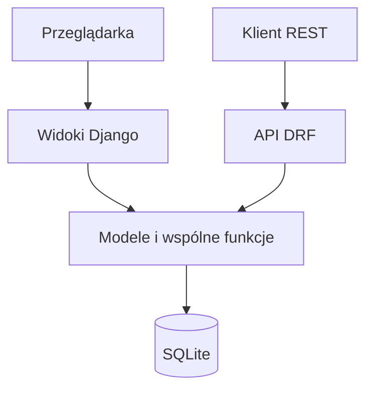
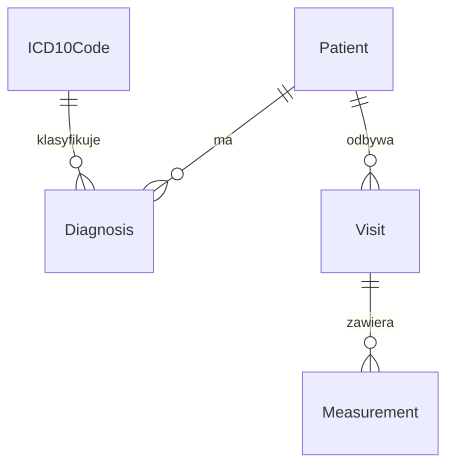

# Specyfikacja implementacji rejestru pacjentów z chorobą przewlekłą

Temat nr 17: **Rejestr pacjentów z chorobą przewlekłą wraz z modułem sprawozdawczości**.

Data: 8 listopada 2026 r.

Dokument określa zakres prostego prototypu zaliczeniowego. Podstawą są formularz zgłoszenia tematu DOCX oraz warunki zaliczenia kursu. Decyzje niewskazane w tych materiałach są opisane poniżej jako przyjęte uproszczenia. Priorytetem jest działający, łatwy do uruchomienia projekt obejmujący wymagane funkcje.

## 1. Zakres i przyjęte uproszczenia

### Wymagania wynikające z formularza

- Odbiorcy: personel medyczny i administrator.
- CRUD pacjentów, rozpoznań ICD-10, wizyt, pomiarów i zapisanych raportów.
- Zestawienia według rozpoznania i okresu: liczba pacjentów, liczba wizyt oraz wyniki pomiarów.
- REST API i wymiana wybranych danych w HL7 FHIR R4.
- Django, Django REST Framework, Django Templates, Bootstrap i SQLite.
- Wyłącznie syntetyczne dane testowe.

### Decyzje upraszczające implementację

| Obszar | Przyjęta realizacja |
| --- | --- |
| Organizacja | Jedna placówka i jedna baza danych. |
| Role | Personel medyczny oraz administrator; bez kont pacjentów. |
| Interfejs | Zwykłe strony i formularze Django. |
| Rozpoznania | Pacjent może mieć kilka rozpoznań ze słownika ICD-10. |
| Wizyty | Rejestr odbytych wizyt z datą i notatką; bez kalendarza rezerwacji. |
| Pomiary | Dwa rodzaje: glukoza we krwi i masa ciała. Pomiar należy do wizyty. |
| Raporty | Jeden formularz: okres i opcjonalnie jeden kod ICD-10. Wynik w tabeli. |
| FHIR | Eksport danych jednego pacjenta do pliku JSON w postaci Bundle R4. |
| Uruchomienie | Lokalnie; do przekazania projektu jeden kontener aplikacji. |

Nie implementować importu FHIR, osobnego serwera FHIR, integracji z P1/NFZ/HAPI, e-recept, powiadomień, zaleceń terapeutycznych, wykresów, eksportu PDF/Excel, aplikacji mobilnej ani funkcji na punkty dodatkowe. Nie dodawać Reacta, JWT, mikroserwisów, kolejek zadań ani osobnego serwera bazy danych.

## 2. Technologie i organizacja kodu

| Element | Wybór |
| --- | --- |
| Python | 3.12 |
| Backend | Django 5.2 LTS, Django REST Framework 3.16 |
| Widoki | Django Templates, ModelForm, Bootstrap 5.3 |
| Dostępność formularzy | django-bootstrap5 do renderowania etykiet, opisów i komunikatów błędów |
| Baza | SQLite, migracje Django |
| Logowanie | Wbudowane uwierzytelnianie i sesje Django |
| Opis API | OpenAPI 3 generowane przez drf-spectacular |
| Testy | Django TestCase i DRF APITestCase |

Dokładne wersje poprawek i zależności zapisać w `requirements.txt` po sprawdzeniu współdziałania. Bootstrap przechowywać lokalnie w `static/`, aby aplikacja po przygotowaniu środowiska nie wymagała CDN.

Wystarczy projekt Django `config` oraz jedna aplikacja `registry`. Korzystać z ORM, formularzy, widoków generycznych i ModelViewSet. Nie wprowadzać własnego frameworka ani warstwy repozytoriów.

| Plik lub katalog | Odpowiedzialność |
| --- | --- |
| `config/` | Ustawienia i główne adresy URL. |
| `registry/models.py` | Encje, relacje i ograniczenia bazy. |
| `registry/forms.py` | Formularze i walidacja interfejsu. |
| `registry/views.py` | Widoki HTML. |
| `registry/serializers.py` | Serializery REST. |
| `registry/api.py` | ViewSety i eksport FHIR. |
| `registry/services.py` | Wspólne obliczanie raportu i zapis zdarzeń audytu. |
| `registry/fhir.py` | Mapowanie modeli na JSON FHIR. |
| `registry/templates/registry/` | Szablony stron. |
| `registry/management/commands/seed_demo.py` | Inicjalizacja słownika, kont i danych syntetycznych. |
| `registry/tests/` | Testy reguł, raportów, uprawnień i API. |

Widoki HTML korzystają bezpośrednio z ORM i wspólnych funkcji. Nie wywołują własnego REST API przez HTTP. Raporty w HTML i API korzystają z tej samej funkcji obliczeniowej.



## 3. Role i dostęp

Wykorzystać standardowy model `User` Django. Konto personelu należy do grupy `personel`, tworzonej podczas inicjalizacji. Administrator korzysta z konta superuser. Sprawdzać rolę na serwerze w widokach HTML i API.

| Czynność | Personel | Administrator |
| --- | --- | --- |
| CRUD pacjentów, ich rozpoznań, wizyt i pomiarów | Tak | Tak |
| CRUD zapisanych raportów | Tak | Tak |
| Eksport FHIR | Tak | Tak |
| Odczyt słownika ICD-10 | Tak | Tak |
| Zarządzanie słownikiem ICD-10 | Nie | Tak, przez Django Admin |
| Zarządzanie kontami | Nie | Tak, przez Django Admin |
| Przegląd rejestru dostępu | Nie | Tak, przez Django Admin |

Wszyscy pracownicy mają dostęp do tej samej demonstracyjnej bazy. Nie tworzyć osobnych uprawnień dla lekarza i pielęgniarki ani ograniczeń do przypisanych pacjentów. Użytkownik niezalogowany lub bez wymaganej roli nie ma dostępu do danych.

## 4. Model danych

Każdy model ma domyślny klucz `id` typu BigAutoField. Modele kliniczne i raport mają `created_at` i `updated_at`. Pozostawić wbudowane tabele użytkowników, grup i sesji Django.

| Model | Pola |
| --- | --- |
| `Patient` | `first_name` CharField(80), `last_name` CharField(80), `birth_date` DateField, `gender` choices: `female`, `male`, `other`. |
| `ICD10Code` | `code` CharField(10, unique=True), `name` CharField(255). |
| `Diagnosis` | `patient` FK Patient, `icd10` FK ICD10Code, `diagnosed_on` DateField, `notes` TextField(blank=True, max_length=1000). |
| `Visit` | `patient` FK Patient, `visit_date` DateField, `notes` TextField(blank=True, max_length=2000), `created_by` FK User. |
| `Measurement` | `visit` FK Visit, `kind` choices: `blood_glucose`, `body_weight`, `value` DecimalField(max_digits=8, decimal_places=2). |
| `Report` | `name` CharField(100), `date_from` DateField, `date_to` DateField, `icd10` nullable FK ICD10Code, `result` JSONField, `created_by` FK User. |
| `AuditLog` | `created_at`, nullable `user` FK User, `action` CharField(30), `object_type` CharField(40), `object_id` CharField(40, blank=True). |

Data pomiaru wynika z `Measurement.visit.visit_date`. Pacjent pomiaru wynika z wizyty. Nie powielać tych pól w tabeli pomiarów. Jednostka i kod LOINC wynikają z `kind`, zgodnie z tabelą w rozdziale 8.



Raport przechowuje parametry i zagregowany wynik, bez kopii kart pacjentów. Autor raportu i wizyty jest ustawiany przez serwer. `AuditLog.object_id` jest tekstem, aby zachować wpis po usunięciu obiektu.

### Walidacja i usuwanie

- Imię i nazwisko są wymagane; usuwać skrajne spacje.
- Data urodzenia nie może być przyszła.
- Data rozpoznania i wizyty nie może poprzedzać daty urodzenia ani być przyszła.
- Ten sam kod ICD-10 można przypisać pacjentowi tylko raz: UniqueConstraint na `(patient, icd10)`.
- Kod ICD-10 musi istnieć w słowniku. Sama zgodność tekstu z wzorcem kodu nie wystarcza.
- Pomiar musi mieć dozwolony rodzaj i dodatnią wartość mieszczącą się w DecimalField. Odrzucać NaN i nieskończoność. Nie implementować medycznej interpretacji wyniku.
- Okres raportu musi spełniać `date_from <= date_to`.
- Zmiana daty urodzenia musi zachować poprawność istniejących dat rozpoznań i wizyt.
- Pola wynikowe, autor i znaczniki czasu są tylko do odczytu w API.

Relacje kliniczne oraz `Report.icd10` ustawić na `on_delete=PROTECT`. Pacjenta z rozpoznaniami lub wizytami, wizyty z pomiarami i używanego kodu słownikowego nie można usunąć przed usunięciem zależności. Interfejs wyświetla komunikat z przyczyną; API zwraca `409`. Wymagane jest potwierdzenie usunięcia w HTML.

W tym prototypie z danymi syntetycznymi wystarczy zwykłe usuwanie rekordów z audytem. Nie implementować archiwizacji, przywracania ani wersjonowania dokumentacji. Konta autorów dezaktywować zamiast usuwać; technicznie odwołania do autora mogą mieć `SET_NULL`.

Reguły muszą działać jednakowo dla formularzy i REST. Ograniczenia unikalności umieścić w bazie, a pozostałą walidację współdzielić między formularzami i serializerami. Nie polegać wyłącznie na walidacji HTML.

## 5. Interfejs użytkownika

Po zalogowaniu użytkownik przechodzi do listy pacjentów. Nawigacja obejmuje **Pacjenci**, **Raporty**, **Wyloguj** oraz **Administracja** widoczne dla administratora.

| Ekran | Zawartość i działania |
| --- | --- |
| Logowanie | Login, hasło, komunikat błędu. |
| Lista pacjentów | Wyszukiwanie po imieniu/nazwisku, filtr ICD-10, stronicowanie po 20 rekordów, dodanie pacjenta. |
| Karta pacjenta | Dane podstawowe, lista rozpoznań i wizyt, edycja, usunięcie, przycisk eksportu FHIR. |
| Formularz pacjenta | Dane modelu Patient. Ten sam szablon do dodawania i edycji. |
| Formularz rozpoznania | Kod i nazwa z listy słownikowej, data rozpoznania, notatka. |
| Szczegóły i formularz wizyty | Data, notatka, lista pomiarów i przejście do ich formularza. |
| Formularz pomiaru | Rodzaj, wartość, jednostka wyświetlana obok pola. |
| Lista i formularz raportów | Lista zapisanych raportów oraz nazwa, daty i opcjonalny kod ICD-10 do utworzenia lub edycji. |
| Szczegóły raportu | Parametry, moment obliczenia, liczby i tabela wyników. |

Wystarczą standardowe tabele, przyciski, komunikaty i wspólny szablon formularza renderowany przez **django-bootstrap5**. Do administratora wykorzystać Django Admin. Bez dodatkowego pulpitu statystycznego.

### Dostępność formularzy

Użyć biblioteki `django-bootstrap5` jako wsparcia dostępności formularzy, także formularza logowania. Dodać pakiet do `requirements.txt`, a `django_bootstrap5` do `INSTALLED_APPS`. Formularze renderować przez wspólny szablon:

```html

<form method="post">
  
  
  <button type="submit" class="btn btn-primary">Zapisz</button>
</form>
```

Zachować widoczne etykiety oraz generowane powiązania opisów i błędów z polami przez `aria-describedby`; sprawdzić `aria-invalid` dla błędnych pól. Korzystać ze standardowych widgetów Django. Bootstrap CSS/JS nadal ładować z lokalnego `static/`. Biblioteka upraszcza formularze; zgodność całych stron z WCAG 2.2 AA wymaga także sprawdzenia klawiatury, fokusu i kontrastu.

Podstawowe ścieżki użytkownika: dodanie pacjenta → rozpoznanie → wizyta → pomiar; utworzenie i odczyt raportu; eksport FHIR z karty pacjenta.

W dokumentacji przygotować co najmniej pięć makiet: lista pacjentów, karta pacjenta, formularz wizyty z pomiarami, formularz raportu, wynik raportu. Dla formularzy zapewnić etykiety, opis błędów, widoczny fokus i obsługę klawiaturą; nie oznaczać informacji wyłącznie kolorem. Sprawdzić wymagania WCAG 2.2 AA wskazane w kryteriach kursu.

## 6. Zasady obliczania raportu

Raport opisuje **pacjentów, którzy mieli wizyty w wybranym okresie**, ich wizyty oraz pomiary z tych wizyt. To przyjęta definicja liczby pacjentów; formularz zgłoszenia nie określa jej dokładniej. Pokazać ten opis obok wyniku, aby nie mylić go z liczbą wszystkich osób zapisanych w rejestrze.

Parametry wejściowe raportu:

| Parametr | Typ | Wymagany | Znaczenie |
| --- | --- | --- | --- |
| `name` | Tekst, do 100 znaków | Tak | Nazwa zapisanego raportu. |
| `date_from` | Data `YYYY-MM-DD` | Tak | Początek okresu, włącznie. |
| `date_to` | Data `YYYY-MM-DD` | Tak | Koniec okresu, włącznie. |
| `icd10` | Identyfikator wpisu słownika `ICD10Code` lub `null` | Nie | Filtr rozpoznania, np. wpis o `id=1` reprezentujący kod `I10`. |

W formularzu `icd10` jest listą wyboru pokazującą kod i nazwę rozpoznania; w API przekazywać identyfikator tego wpisu, zgodnie z polem `Report.icd10`. Brak wartości lub `null` oznacza wszystkie rozpoznania i brak filtrowania pacjentów po chorobie. Nieistniejący identyfikator zwraca błąd walidacji `400`. Przy odczycie wyniku pokazać wybrany kod ICD-10 w parametrach raportu albo opis „Wszystkie rozpoznania”.

1. Wybrać wizyty z `date_from <= visit_date <= date_to`.
2. Jeśli podano kod, pozostawić wizyty pacjentów mających ten kod z `diagnosed_on <= visit_date`. Użyć `Exists` lub podzapytania, aby połączenia z rozpoznaniami nie powielały wizyt.
3. `visit_count` to liczba wybranych wizyt.
4. `patient_count` to liczba różnych `patient_id` w wybranych wizytach.
5. Dla pomiarów należących do tych wizyt obliczyć osobno dla każdego rodzaju: liczbę wyników, średnią, minimum i maksimum.

Filtr dotyczy rozpoznania pacjenta. Nie oznacza, że dana choroba była powodem każdej zliczonej wizyty. Nie tworzyć dodatkowej relacji rozpoznanie–wizyta.

Przykładowy zapis pola `Report.result`:

```json
{
  "patient_count": 1,
  "visit_count": 2,
  "measurements": [
    {"kind": "blood_glucose", "unit": "mg/dL", "count": 2, "avg": "110.00", "min": "100.00", "max": "120.00"},
    {"kind": "body_weight", "unit": "kg", "count": 0, "avg": null, "min": null, "max": null}
  ]
}
```

Obliczać z wartości Decimal, zaokrąglać wynik do dwóch miejsc przy zapisie. W JSON aplikacji wartości dziesiętne zapisywać jako ciągi znaków. Dla pustego zbioru zwracać liczności `0` i statystyki `null`; interfejs pokazuje „Brak pomiarów”. Nie łączyć różnych rodzajów ani jednostek w jedną średnią.

Raport powstaje synchronicznie i zapisuje wynik w bazie. Późniejsze zmiany wizyt nie przeliczają go automatycznie. **Każde zapisanie edycji raportu ponownie oblicza wynik** na aktualnych danych; przycisk nazwać „Zapisz i przelicz”. Odczyt raportu zwraca wyłącznie zapisany wynik.

## 7. REST API

Prefiks: `/api/v1/`. Serializacja JSON. Wystarczą zwykłe, płaskie endpointy DRF; odwołania do innych modeli przekazywać przez ich `id`.

| Zasób | Adres kolekcji | Metody |
| --- | --- | --- |
| Pacjenci | `/api/v1/patients/` | GET, POST |
| Rozpoznania pacjentów | `/api/v1/diagnoses/` | GET, POST |
| Wizyty | `/api/v1/visits/` | GET, POST |
| Pomiary | `/api/v1/measurements/` | GET, POST |
| Zapisane raporty | `/api/v1/reports/` | GET, POST |
| Słownik ICD-10 | `/api/v1/icd10/` | GET |

Dla pierwszych pięciu zasobów adres `/{id}/` obsługuje GET, PUT, PATCH i DELETE. Słownik jest zarządzany przez administratora w Django Admin, bez osobnego API zapisu.

| Dodatkowy adres | Działanie |
| --- | --- |
| `GET /api/v1/patients/{id}/fhir-export/` | Pobranie Bundle R4 z danymi pacjenta. |
| `GET /api/schema/` | Formalny opis OpenAPI, dostępny po zalogowaniu. |

Listy stronicować przez `PageNumberPagination`, 20 rekordów na stronę. Odpowiedź: `count`, `next`, `previous`, `results`. Porządek list ma być stabilny: pacjenci po nazwisku, imieniu i id; wizyty po dacie malejąco i id; pozostałe po id.

Wystarczające filtry: `patients?search=...&icd10=I10`, `diagnoses?patient=1`, `visits?patient=1&date_from=2026-10-01&date_to=2026-10-31`, `measurements?visit=1`. W filtrach dat odrzucać błędny format lub odwrócony okres kodem `400`. Wyszukiwanie słownika po kodzie lub nazwie. Nie dodawać zaawansowanego języka zapytań.

### Uwierzytelnianie i odpowiedzi

Wykorzystać `SessionAuthentication`. Logowanie przez `/accounts/login/`, wylogowanie przez POST. Włączyć standardową ochronę CSRF również dla logowania; żądania zmieniające dane wymagają tokenu CSRF. Nie uruchamiać osobnego mechanizmu wydawania tokenów API.

| Kod | Znaczenie |
| --- | --- |
| 200 | Odczyt lub poprawna edycja. |
| 201 | Utworzenie rekordu lub raportu. |
| 204 | Usunięcie rekordu. |
| 400 | Błąd danych, pól lub parametrów. |
| 403 | Brak sesji, uprawnienia lub poprawnego CSRF w przyjętej konfiguracji sesyjnej DRF. |
| 404 | Rekord nie istnieje. |
| 409 | Usuwanie zablokowane przez zależności. |

Pozostawić standardowy format błędów DRF przypisanych do pól. Dla blokady usunięcia zwracać np. `{"detail": "Wizyta ma przypisane pomiary. Najpierw usuń pomiary."}`. Do API nie stosować przekierowania do strony logowania; przekierowania dotyczą widoków HTML.

### Przykłady

`POST /api/v1/measurements/` po zalogowaniu i z poprawnym CSRF:

```json
{"visit": 1, "kind": "blood_glucose", "value": "100.00"}
```

Odpowiedź `201`, oprócz automatycznych znaczników czasu:

```json
{"id": 1, "visit": 1, "kind": "blood_glucose", "value": "100.00"}
```

`POST /api/v1/reports/`:

```json
{"name": "I10 październik", "date_from": "2026-10-01", "date_to": "2026-10-31", "icd10": 1}
```

Przyjąć, że rekord słownika o `id=1` ma kod `I10`. Odpowiedź `201` zawiera powyższe parametry, `id`, autora, znaczniki czasu i obliczone `result`. Nie przyjmować `result` podanego przez klienta. Aktualizacja raportu korzysta z tych samych zasad obliczeń.

OpenAPI ma opisywać pola, uprawnienia, dostępne filtry, kody odpowiedzi i przykłady, w tym typ odpowiedzi eksportu. Plik schematu dołączyć do dokumentacji; osobny interfejs Swagger nie jest potrzebny.

## 8. Słowniki i eksport HL7 FHIR R4

Zastosować FHIR **R4 4.0.1**. Eksport to plik do przekazania innemu systemowi; nie implementować serwera FHIR ani importu. Zakres wymiany z formularza realizuje odczyt danych w formacie standardu przez własne API.

Słownik ICD-10 może być małym, jawnym podzbiorem używanym w demonstracji, np. `I10` oraz `E11.9`. Opisać źródło kodów i warunki wykorzystania. Nie importować całej klasyfikacji ani SNOMED CT i ICD-9, które nie są potrzebne do tego zakresu.

Stałe mapowanie rodzajów pomiarów:

| `kind` | Znaczenie | LOINC | Jednostka UCUM | Kategoria Observation |
| --- | --- | --- | --- | --- |
| `blood_glucose` | Stężenie masowe glukozy we krwi | `2339-0` | `mg/dL` | `laboratory` |
| `body_weight` | Masa ciała | `29463-7` | `kg` | `vital-signs` |

Kod `2339-0` dotyczy pomiaru we krwi; nie opisywać go jako badania wyłącznie surowicy lub osocza. Wystarczy stała definicja dwóch rodzajów w kodzie aplikacji, bez tabeli konfiguracji pomiarów.

### Zawartość eksportu

Odpowiedź `200` ma `Content-Type: application/fhir+json` i `Content-Disposition: attachment; filename="patient-1-fhir.json"`. Obiekt nadrzędny: `resourceType=Bundle`, `type=collection`, `timestamp` oraz `entry`.

Bundle zawiera jednego Patient, jego Diagnosis jako Condition, jego Visit jako Encounter i pomiary z tych wizyt jako Observation. Nie eksportuje zapisanych raportów statystycznych ani kont personelu.

| Model | Zasób i mapowanie |
| --- | --- |
| `Patient` | `Patient.name[0].given`, `family`, `birthDate`, `gender`; lokalny identyfikator pacjenta w `identifier` z systemem `urn:psim:patient-id`. |
| `Diagnosis` | `Condition.subject`, `code.coding` z systemem `http://hl7.org/fhir/sid/icd-10`; `clinicalStatus=active`, `verificationStatus=confirmed`, `recordedDate=created_at`. |
| `Visit` | `Encounter.subject`, `status=finished`, `class.code=AMB`, `class.system=http://terminology.hl7.org/CodeSystem/v3-ActCode`, `period.start=visit_date`. |
| `Measurement` | `Observation.status=final`, `subject`, `encounter`, `effectiveDateTime=visit.visit_date`, `code.coding` LOINC, `category` oraz `valueQuantity`. |

W MVP rozpoznania są aktualnymi chorobami przewlekłymi, bez modelowania remisji i epizodów. Nie mapować daty postawienia rozpoznania na datę początku choroby. `recordedDate` oznacza rzeczywistą datę utworzenia wpisu.

Dla Condition użyć systemów `http://terminology.hl7.org/CodeSystem/condition-clinical` oraz `http://terminology.hl7.org/CodeSystem/condition-ver-status`. Dla kategorii Observation użyć `http://terminology.hl7.org/CodeSystem/observation-category`, dla LOINC `http://loinc.org`, a dla jednostek `http://unitsofmeasure.org`.

Na potrzeby eksportu wyliczać identyfikator UUID zasobu przez `uuid5(NAMESPACE_URL, "urn:psim:{ResourceType}:{id}")`. `resource.id` to tekst tego UUID, `entry.fullUrl` ma postać `urn:uuid:{uuid}`. Wszystkie `reference` wskazują odpowiadające im `fullUrl` w tej samej paczce. Nie dodawać pól UUID do bazy ani fikcyjnych endpointów FHIR.

W FHIR `valueQuantity.value` jest liczbą JSON, nie ciągiem znaków. Pominąć puste opcjonalne elementy zamiast wypełniać je `null`. Dla masy ciała uwzględnić wymagania profilu Body Weight, w tym `meta.profile[0]=http://hl7.org/fhir/StructureDefinition/bodyweight` i kategorię `vital-signs`.

Przykład części Observation dla glukozy, z pominięciem referencji i pozostałych pól zasobu:

```json
{
  "code": {"coding": [{"system": "http://loinc.org", "code": "2339-0"}]},
  "valueQuantity": {"value": 100.00, "unit": "mg/dL", "system": "http://unitsofmeasure.org", "code": "mg/dL"}
}
```

Sprawdzić, że eksport zawiera wymagane pola R4 i zamknięty zestaw referencji. Przed oddaniem zwalidować przykładowy Bundle walidatorem HL7 dla wersji `4.0.1`. Walidator jest narzędziem sprawdzającym plik, nie usługą wymaganą do uruchomienia aplikacji. Nie deklarować obsługi innych zasobów, profili krajowych ani pełnej zgodności serwera FHIR.

## 9. Minimum bezpieczeństwa i audytu

- Każdy widok danych, API, schemat API i eksport wymagają logowania i właściwej roli.
- Używać mechanizmów haseł, sesji i CSRF Django. Nie budować własnego przechowywania haseł.
- `SECRET_KEY` i hasła inicjalizacyjne pobierać ze środowiska; nie zapisywać ich w kodzie ani repozytorium.
- Włączyć automatyczne escapowanie szablonów. Notatki są zwykłym tekstem.
- Tworzenie/edycję/usunięcie rekordu wraz z wpisem audytu wykonywać w `transaction.atomic()`.
- Zapisywać zdarzenia: logowanie, wylogowanie, odczyt listy lub szczegółów danych, utworzenie, edycja, usunięcie oraz eksport FHIR. Nie logować każdego pliku statycznego.
- Audyt przechowuje użytkownika, czas, akcję i identyfikator obiektu. Bez haseł, treści notatek i pełnych odpowiedzi API. W Django Admin rejestr ma być tylko do odczytu.
- Wariant uruchamiany przez sieć ma używać HTTPS i bezpiecznych ciasteczek sesji/CSRF. Lokalny pokaz po HTTP ograniczyć do `127.0.0.1`; nie udostępniać go jako instalacji sieciowej.

Wymóg opisu szyfrowania i audytu wynika z kryteriów zaliczenia. W dokumentacji opisać wariant HTTPS, np. z certyfikatem przez serwer pośredniczący; nie budować publicznego hostingu na potrzeby lokalnej demonstracji.

## 10. Dane testowe i testy odbioru

Komenda `python manage.py seed_demo` tworzy słownik ICD-10, grupę personelu, konto administratora, konto personelu oraz około 10 fikcyjnych pacjentów z rozpoznaniami, wizytami i pomiarami. Wystarczy prosty generator lub stały zestaw danych; biblioteka Faker nie jest potrzebna. Ponowne uruchomienie komendy nie powiela danych i nie usuwa zmian użytkownika.

Hasła kont demonstracyjnych przekazać przy inicjalizacji i opisać sposób ich ustawienia w README. W paczce przekazywanej prowadzącemu podać dane kont testowych zgodnie z warunkami kursu. Nie używać danych autorów jako danych pacjentów ani generować numerów PESEL.

Najważniejsza mała próbka do testu raportu:

- Pacjent A ma rozpoznanie I10 od 1 września 2026 r., dwie wizyty w październiku i po jednym pomiarze glukozy: 100 oraz 120 mg/dL.
- Pacjent B ma wyłącznie inne rozpoznanie i wizytę w październiku.
- Pacjent C ma I10, ale nie ma wizyty w październiku.
- Pacjent A ma także wizytę poza październikiem; nie powinna wejść do wyniku.

Dla raportu `I10`, 1–31 października: **1 pacjent, 2 wizyty, 2 pomiary glukozy, średnia 110, minimum 100, maksimum 120**. Pacjent C nie jest liczony, zgodnie z przyjętą definicją raportu.

| Test | Oczekiwany wynik |
| --- | --- |
| Dostęp bez logowania i dostęp konta bez roli | Brak danych; HTML kieruje do logowania, API odrzuca żądanie. |
| Personel próbuje wejść do administracji | Brak uprawnień. |
| Cykl CRUD głównych modeli | Zapis i odczyt działają w formularzach oraz API. |
| Duplikat rozpoznania lub błędna data | Błąd walidacji bez zapisu. |
| Usunięcie pacjenta lub wizyty z zależnościami | Czytelna blokada, API 409. |
| Raport na powyższej próbce, także z drugim rozpoznaniem pacjenta A | Podane liczby, brak podwójnego zliczania. |
| Raport bez danych i pomiary na granicach okresu | Zera/null dla pustych zbiorów; obie daty graniczne włączone. |
| Zmiana pomiaru po zapisaniu raportu | Stary wynik pozostaje; zapis edycji raportu przelicza go ponownie. |
| Raport przez HTML i API | Te same wyniki. |
| Parametr raportu `icd10` | Wybrany kod filtruje dane; brak wartości lub null wyłącza filtr; nieistniejący wpis daje błąd 400. |
| Formularze django-bootstrap5 | Etykiety i opisy są powiązane z polami, błędy są czytelne, formularz można obsłużyć klawiaturą. |
| Eksport FHIR | Poprawne typy, statusy, kody, liczby JSON i referencje; dane tylko wskazanego pacjenta. |
| Odczyt karty, zmiana danych i eksport | Powstają właściwe wpisy audytu. |
| Uruchomienie według README w czystym środowisku | Migracje, dane demo, logowanie i scenariusz działają. |

Wystarczy ten zestaw testów i ręczna demonstracja interfejsu. Nie dodawać testów obciążeniowych, rozbudowanej automatyzacji przeglądarki ani celów procentowego pokrycia kodu.

## 11. Uruchomienie i kolejność realizacji

Typowy start developerski: utworzenie środowiska Python, instalacja `requirements.txt`, ustawienie `SECRET_KEY`, migracje, `seed_demo`, `python manage.py runserver 127.0.0.1:8000`. W README podać dokładne polecenia dla docelowego systemu.

Do wymaganej wersji gotowej do uruchomienia przygotować jeden `Dockerfile` i `docker-compose.yml`: jedna usługa Django, SQLite w trwałym wolumenie, port hosta związany z `127.0.0.1`. W kontenerze użyć Gunicorn i WhiteNoise do serwowania aplikacji oraz lokalnych plików statycznych. Bez dodatkowych usług. Pierwsze przygotowanie zależności może wymagać internetu; aplikacja po przygotowaniu działa lokalnie.

Kolejność implementacji:

1. Projekt Django, modele, migracje, logowanie, role i minimalny audyt.
2. Słownik i dane demonstracyjne, następnie formularze CRUD.
3. Wspólna funkcja obliczania raportu i zapisane raporty.
4. ViewSety REST oraz schemat OpenAPI.
5. Eksport FHIR i sprawdzenie pliku.
6. Testy odbioru, instrukcja i opakowanie do uruchomienia.

Na każdym etapie realizować tylko funkcje określone w tej specyfikacji. Powtarzalne fragmenty upraszczać mechanizmami Django, zamiast dodawać kolejne biblioteki.

## 12. Powiązanie z warunkami zaliczenia

Samo SPEC.md nie zastępuje dokumentacji projektowej ani wymogów organizacyjnych kursu. Poniższe elementy trzeba przygotować w ramach oddania, bez rozszerzania funkcjonalności aplikacji.

| Kryterium | Minimalny materiał |
| --- | --- |
| E1 | Formularz tematu i uzyskanie akceptacji prowadzącego. |
| E2 | Cel, odbiorcy, krótki przegląd istniejących rozwiązań ze źródłami, wykonalność, ryzyka i potencjał komercjalizacji. |
| E3 | Model danych i diagram ERD, opis elementów EDM, ICD-10 i LOINC, tabela mapowania FHIR. |
| E4 | Diagram komponentów oraz wdrożenia, formalny opis API, przykłady, role, szyfrowanie i audyt. |
| E5 | Persony, ścieżki i nawigacja, co najmniej 5 makiet, czytelność i sprawdzenie dostępności. |
| E6 | Kategorie danych i podstawy prawne, środki ochrony, retencja/usuwanie oraz uzasadniona analiza kwalifikacji oprogramowania według MDR. |
| E7 | Spójna dokumentacja PDF i edytowalna według wzorca kursowego, bibliografia oraz rzeczywisty podział pracy w zespole. |
| E8 | Działający prototyp, kod, zależności, testy, dane syntetyczne i instrukcja uruchomienia. |
| E9 | Prezentacja 10–12 minut i demonstracja aplikacji. |

W części prawnej odnieść się do przepisów wymienionych w warunkach kursu, sprawdzając ich aktualność: RODO, system informacji w ochronie zdrowia, wymagania dla SIM, dokumentacja medyczna i prawa pacjenta. Odróżnić prototyp na danych syntetycznych od hipotetycznego wdrożenia z danymi rzeczywistymi. Sam rejestr i eksport nie są dowodem zgodności prawnej ani rozstrzygnięciem klasyfikacji MDR.

Do przekazania przygotować strukturę wskazaną w PDF: `00_README.txt`, `01_Dokumentacja/`, `02_Aplikacja_kod/`, `03_Aplikacja_uruchom/`, `04_Dane_testowe/`, `05_Prezentacja/`, `06_Oswiadczenia/`. Uwzględnić wymagane oświadczenia, w tym zakres wykorzystania AI. Materiały oddać przez e-portal i na opisanym nośniku zgodnie z zasadami kursu.

Warunki odnoszą się do osobnego wzorca dokumentacji. Jego pełnej treści nie ma w dwóch materiałach źródłowych tej specyfikacji; układ końcowej dokumentacji należy porównać z właściwym wzorcem, gdy będzie dostępny.

## 13. Źródła

- [Formularz zgłoszenia tematu nr 17](https://chatgpt.com/library?file_id=libfile_3311d24cee308191b3eb40f48c4c0b05&account_id=personal), DOCX, zakres i stos technologiczny.
- [Warunki zaliczenia kursu](https://chatgpt.com/library?file_id=libfile_cef21c3f3e688191a344c1382d812f61&account_id=personal), szczególnie strony 9–14.
- [Django 5.2](https://docs.djangoproject.com/en/5.2/releases/5.2/) i [DRF 3.16](https://www.django-rest-framework.org/community/3.16-announcement/) — wersje i zgodność.
- [Sesje i CSRF w DRF](https://www.django-rest-framework.org/topics/ajax-csrf-cors/) oraz [drf-spectacular](https://drf-spectacular.readthedocs.io/en/stable/readme.html).
- [django-bootstrap5 — formularze](https://django-bootstrap5.readthedocs.io/en/stable/forms.html), [uruchomienie](https://django-bootstrap5.readthedocs.io/en/stable/quickstart.html) i [zmiany dotyczące ARIA oraz zgodności z Django 5.2](https://django-bootstrap5.readthedocs.io/en/stable/changelog.html).
- FHIR R4: [Patient](https://hl7.org/fhir/R4/patient.html), [Condition](https://hl7.org/fhir/R4/condition.html), [Encounter](https://hl7.org/fhir/R4/encounter.html), [Observation](https://hl7.org/fhir/R4/observation.html), [Bundle](https://hl7.org/fhir/R4/bundle.html), [Vital Signs](https://hl7.org/fhir/R4/observation-vitalsigns.html).
- LOINC: [2339-0](https://loinc.org/2339-0) i [29463-7](https://loinc.org/29463-7); [ICD-10 WHO](https://icd.who.int/browse10/2019/en).
